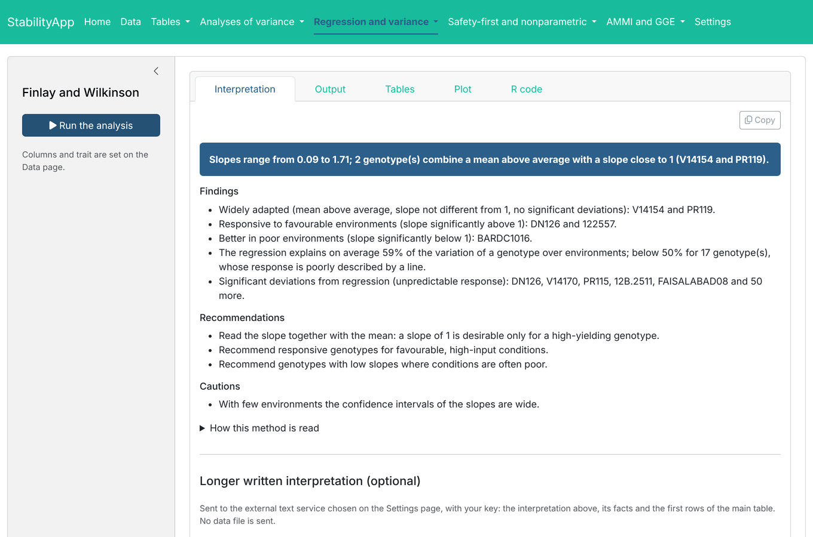

# StabilityApp: Interactive Stability Analysis of Multi-Environment
Trials


[](https://CRAN.R-project.org/package=StabilityApp)
[](https://cran.r-project.org/web/checks/check_results_StabilityApp.html)
[](https://CRAN.R-project.org/package=StabilityApp)
[](https://CRAN.R-project.org/package=StabilityApp)
[](https://myaseen208.r-universe.dev/StabilityApp)
[](https://github.com/myaseen208/StabilityApp/actions/workflows/R-CMD-check.yml)
[](https://github.com/myaseen208/StabilityApp)
[](https://cran.r-project.org/)
[](https://CRAN.R-project.org/package=StabilityApp)
[](https://www.gnu.org/licenses/gpl-3.0.html)
[](https://www.repostatus.org/#active)
[](https://github.com/myaseen208/StabilityApp/commits)

## Overview

**StabilityApp** runs the twenty analyses of the package **stability**
in a web browser: tables of means and effects; analyses of variance in
each environment, combined and Eberhart and Russell’s; Finlay and
Wilkinson’s regression, variance measures, Shukla’s stability variance
with Kang’s yield-stability statistic, Kang’s rank-sum and Fox’s top
third; Eskridge’s safety-first indices, Annicchiarico’s reliability
index, Lin and Binns’ superiority measure and Huehn’s nonparametric
statistics; AMMI analysis, biplots and stability values; and the GGE
biplot with the which-won-where, mean-stability and discrimination views
in each of its three scalings.

Every analysis shows

- an **interpretation written for its method** and computed from its
  results (`stability::stab_interpret()`);
- its **tables** (CSV and Excel export) and **plots** (PNG and PDF);
- the **R code** that repeats it.

A longer written interpretation can be requested from an external text
service with your own key (`sa_services()`); the request (`sa_prompt()`)
is specific to the method and contains the computed findings, which the
text must keep to. No data file is sent.



## Installation

``` r
install.packages("StabilityApp")
# development version
# install.packages("remotes")
remotes::install_github("myaseen208/StabilityApp")
```

The package **stability**, which does the analyses, and the other
packages it needs are installed with it automatically. To install from a
downloaded source file, use a function that also installs the
dependencies:

``` r
# install.packages("remotes")
remotes::install_local("StabilityApp_1.0.0.tar.gz")
```

(`install.packages("StabilityApp_1.0.0.tar.gz", repos = NULL)` does not
install dependencies; with it, run `install.packages("stability")`
first.)

## Start

``` r
library(StabilityApp)
StabilityApp(
    launch.browser = TRUE
  )
```

## Learn more

- Vignettes: `browseVignettes("StabilityApp")`, as HTML and as PDF.
- Site: <https://myaseen208.com/StabilityApp/>
- The analyses in R: the package **stability**.

## Citation

    Yaseen M, Eskridge K (2026). _StabilityApp: Interactive Stability
    Analysis of Multi-Environment Trials_. R package version 1.0.0 (first
    released 2024), <https://CRAN.R-project.org/package=StabilityApp>.

BibTeX:

    @Manual{StabilityApp,
      title = {{StabilityApp}: Interactive Stability Analysis of Multi-Environment Trials},
      author = {Muhammad Yaseen and Kent Eskridge},
      year = {2026},
      note = {R package version 1.0.0 (first released 2024)},
      url = {https://CRAN.R-project.org/package=StabilityApp},
    }
